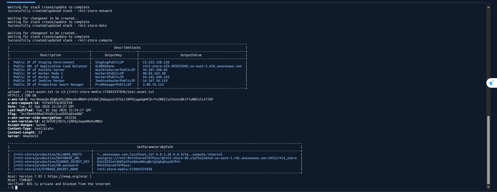

# AWS Infrastructure Deployment Guide

This directory contains the CloudFormation templates and automation scripts for provisioning the three-tier AWS architecture for the RMIT Store application.

## Prerequisites

- Access to AWS Academy / AWS Management Console with CloudShell enabled.
- A pre-existing EC2 Key Pair named `devops_project_key` in region `us-east-1`.

---

## Architecture Overview

1. **`01-network.yml`**: Provisions VPC, 2 Public Subnets, 2 Private Subnets across 2 AZs, Internet Gateway, Route Tables, and Security Groups.
2. **`02-data.yml`**: Provisions RDS PostgreSQL, S3 Media Bucket, ECR Repositories (API & Client), and SSM Parameter Store entries.
3. **`03-compute.yml`**: Provisions Jenkins Master, Ansible Controller, Staging Server, Production Swarm Manager, Worker Nodes, and the Application Load Balancer (ALB).

---

## Deployment via AWS CloudShell

1. Upload or clone this repository inside **AWS CloudShell**.
2. Make the script executable:
   ```bash
   chmod +x aws-capability-check.sh
   ```
3. Execute the deployment script:
   ```bash
   ./aws-capability-check.sh
   ```

---

## Expected Outcomes & Verification

Upon executing the `aws-capability-check.sh` script, the deployment will automatically complete the following validation and verification steps:

- **Template Validation**: All three CloudFormation templates (`01-network.yml`, `02-data.yml`, `03-compute.yml`) pass YAML syntax and schema checks via `aws cloudformation validate-template`.
- **Stack Creation**: The stacks reach a status of `Successfully created/updated` in sequential order:
  1. `rmit-store-network`
  2. `rmit-store-data`
  3. `rmit-store-compute`
- **Output Table Generation**: A summary table displaying public IP addresses for compute nodes (Jenkins Master, Ansible, Staging, Swarm Manager, Workers) and the ALB DNS endpoint is printed to the console.
- **S3 Media Access Verification**: Uploads a `test-asset.txt` to the S3 bucket and verifies an `HTTP/1.1 200 OK` response over HTTPS for anonymous read operations.
- **SSM Parameter Store Verification**: Retrieves and displays all key-value secrets stored under the `/rmit-store` namespace in a formatted terminal table.
- **RDS Network Isolation**: Performs a network connectivity test (`nc -zv -w 3 <RDS_ENDPOINT> 5432`). The operation times out as expected, proving that the PostgreSQL database is isolated within private subnets and unreachable directly from the public internet.

### Deployment Verification Screenshot


